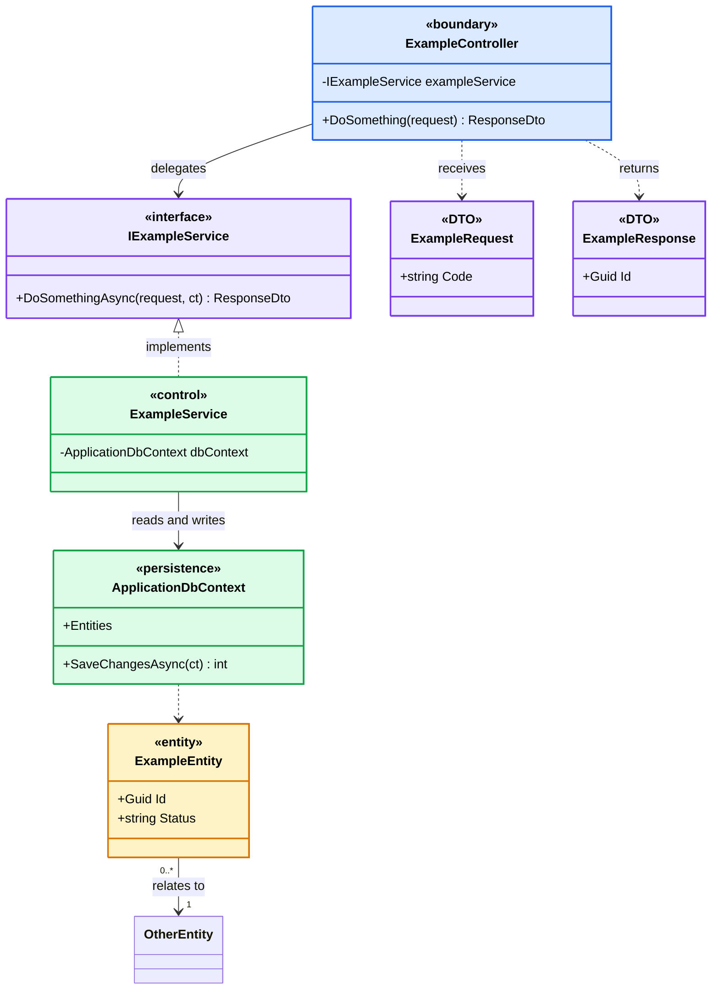

# CLASS DIAGRAM GUIDELINES & STANDARDS (MERMAID FOR DRAW.IO)

Tài liệu này quy định tiêu chuẩn thiết kế và cú pháp viết **Class Diagram (Mermaid)** trong repository `smart-locking-diagram`. Tất cả Agent hoặc Developer khi tạo mới hoặc cập nhật Class Diagram **BẮT BUỘC** phải tuân theo các quy tắc dưới đây để đảm bảo tính nhất quán và tương thích 100% khi import vào **Draw.io** (`Arrange -> Insert -> Advanced -> Mermaid`).

---

## 1. Cú pháp định nghĩa Class & Stereotype (Quan trọng nhất)

### ❌ KHÔNG dùng cú pháp cũ gây lỗi parser:
Không đặt thẻ `<<stereotype>>` bên trong thân class hoặc trên dòng riêng biệt:
```mermaid
%% LỖI TRÊN DRAW.IO:
class DeliveryRequestsController {
    <<boundary>>
    -IDeliveryRequestService deliveryRequestService
}
```

### ✅ BẮT BUỘC dùng nhãn `["«stereotype»\nTênClass"]`:
Đưa stereotype vào tên hiển thị với cặp ký tự guillemet `« »` và **xuống dòng** để phân tách rõ ràng giữa stereotype và tên class:
```mermaid
class DeliveryRequestsController["«boundary»
DeliveryRequestsController"] {
    -IDeliveryRequestService deliveryRequestService

    +ReserveCompartment(requestId)
    +ConfirmDropOff(requestId)
}
```

### Các Stereotype chuẩn quy ước:
- `«boundary»`: Dành cho Controllers, Presentation API endpoints.
- `«interface»`: Dành cho Application/Domain Service Interfaces, Repository Interfaces.
- `«control»`: Dành cho Service Implementations, Background Workers, Handlers.
- `«persistence»`: Dành cho DbContext, Storage Contexts.
- `«DTO»`: Dành cho Request DTOs, Response DTOs.
- `«entity»`: Dành cho Domain Entities, Aggregate Roots.

---

## 2. Tiêu chuẩn màu sắc & Style (Theme chuẩn Tailwind)

Draw.io đôi khi bỏ qua lệnh `classDef` trong Mermaid Class Diagram, do đó **bắt buộc áp dụng style tường minh (`style ClassName ...`)** ở cuối file.

Bảng màu thống nhất cho toàn bộ hệ thống:

| Phân loại | Stereotype | Màu nền (`fill`) | Màu viền (`stroke`) | Độ dày viền | Màu chữ (`color`) |
| :--- | :--- | :--- | :--- | :--- | :--- |
| **Boundary / Controller** | `«boundary»` | `#dbeafe` (Blue-100) | `#2563eb` (Blue-600) | `stroke-width:2px` | `#000000` |
| **Interfaces** | `«interface»` | `#ede9fe` (Violet-100) | `#7c3aed` (Violet-600) | `stroke-width:2px` | `#000000` |
| **DTOs (Request/Response)** | `«DTO»` | `#ede9fe` (Violet-100) | `#7c3aed` (Violet-600) | `stroke-width:2px` | `#000000` |
| **Services / Controls / DbContext** | `«control»`, `«persistence»` | `#dcfce7` (Emerald-100) | `#16a34a` (Emerald-600) | `stroke-width:2px` | `#000000` |
| **Domain Entities** | `«entity»` | `#fef3c7` (Amber-100) | `#d97706` (Amber-600) | `stroke-width:2px` | `#000000` |

### Khối Style mẫu chuẩn:
```mermaid
%% =========================================================
%% STYLES
%% =========================================================

%% Explicit styles are used because draw.io may ignore classDef/::: in class diagrams.
style DeliveryRequestsController fill:#dbeafe,stroke:#2563eb,color:#000000,stroke-width:2px

style IDeliveryRequestService fill:#ede9fe,stroke:#7c3aed,color:#000000,stroke-width:2px

style DeliveryRequestService fill:#dcfce7,stroke:#16a34a,color:#000000,stroke-width:2px
style ApplicationDbContext fill:#dcfce7,stroke:#16a34a,color:#000000,stroke-width:2px

style InitiateDeliveryRequest fill:#ede9fe,stroke:#7c3aed,color:#000000,stroke-width:2px
style InitiateDeliveryResponse fill:#ede9fe,stroke:#7c3aed,color:#000000,stroke-width:2px

style DeliveryRequest fill:#fef3c7,stroke:#d97706,color:#000000,stroke-width:2px
style Locker fill:#fef3c7,stroke:#d97706,color:#000000,stroke-width:2px
```

---

## 3. Quy tắc Mối quan hệ (Relationships) & Mũi tên

Bộ parser Mermaid của Draw.io rất dễ lỗi nếu dùng cú pháp mũi tên ngược hoặc sai chiều:

1. **Interface Realization (Kế thừa / Thực thi Interface)**:
   - ✅ Viết: `Interface <|.. Implementation : implements`
   - ❌ Không viết: `Implementation ..|> Interface` (Gây lỗi trên nhiều phiên bản Draw.io).

2. **Chiều quan hệ và Cardinality / Multiplicity**:
   - ✅ Luôn ưu tiên chiều xuôi từ trái sang phải `-->`:
     ```mermaid
     DeliveryRequest "0..*" --> "1" Locker : hosts
     Locker "1" *-- "1..*" LockerCompartment : contains
     DeliveryRequest "1" --> "0..*" CompartmentReservation : reserves
     ```
   - ❌ Tránh dùng mũi tên ngược kèm cardinality:
     ```mermaid
     %% DỄ LỖI TRÊN DRAW.IO:
     Locker "1" <-- "0..*" DeliveryRequest : hosts
     ```

3. **Dependency (Phụ thuộc)**:
   - Dùng nét đứt `..>`:
     ```mermaid
     DeliveryRequestsController ..> InitiateDeliveryRequest : receives
     DeliveryRequestsController ..> InitiateDeliveryResponse : returns
     ApplicationDbContext ..> DeliveryRequest
     ```

---

## 4. Cấu trúc khung (Template Skeleton) mẫu cho file Diagram

Mỗi file Class Diagram nên được cấu trúc tuần tự theo các khu vực sau:


