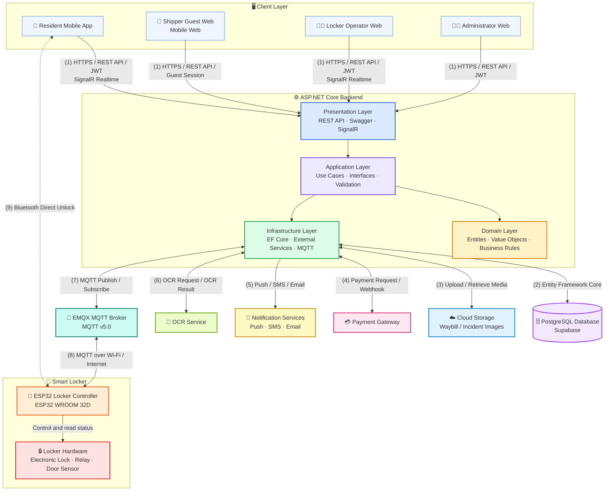

# Architecture Diagram

---

## Guidelines & Standards

- Xem quy chuẩn và hướng dẫn vẽ Class Diagram (Mermaid tương thích Draw.io) tại: [CLASS_DIAGRAM_GUIDELINES.md](CLASS_DIAGRAM_GUIDELINES.md)
- Xem quy chuẩn và hướng dẫn vẽ Sequence Diagram (Mermaid tương thích Draw.io) tại: [SEQUENCE_DIAGRAM_GUIDELINES.md](SEQUENCE_DIAGRAM_GUIDELINES.md)
