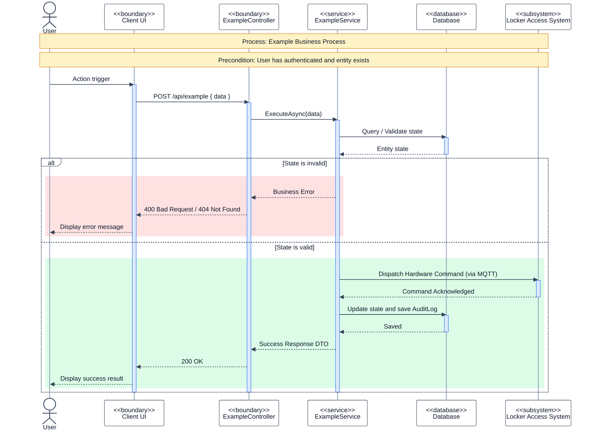

# SEQUENCE DIAGRAM GUIDELINES & STANDARDS (MERMAID FOR DRAW.IO)

Tài liệu này quy định tiêu chuẩn thiết kế và cú pháp viết **Sequence Diagram (Mermaid)** trong repository `smart-locking-diagram`. Tất cả Agent hoặc Developer khi tạo mới hoặc cập nhật Sequence Diagram **BẮT BUỘC** phải tuân theo các quy tắc dưới đây để đảm bảo tính đồng bộ, chuyên nghiệp và tương thích 100% khi import vào **Draw.io** (`Arrange -> Insert -> Advanced -> Mermaid`).

---

## 1. Cấu hình Theme & Màu sắc chuẩn (Bắt buộc ở đầu mỗi diagram)

Mỗi file Mermaid Sequence Diagram bắt buộc phải có khối cấu hình `%%{init: ...}%%` ở đầu để đồng bộ giao diện hiển thị:

```mermaid
%%{init: {
  "theme": "base",
  "themeVariables": {
    "actorBkg": "#FFFFFF",
    "actorBorder": "#334155",
    "actorTextColor": "#0F172A",
    "actorLineColor": "#94A3B8",
    "signalColor": "#334155",
    "signalTextColor": "#0F172A",
    "activationBkgColor": "#DBEAFE",
    "activationBorderColor": "#2563EB",
    "noteBkgColor": "#FEF3C7",
    "noteBorderColor": "#D97706",
    "noteTextColor": "#111827"
  }
}}%%
```

### Màu sắc phân nhánh nghiệp vụ (`rect rgb(...)`):
- **Luồng Lỗi / Thất bại (Error Path)**: Dùng đỏ nhạt `rect rgb(254,226,226)` (Red-100)
- **Luồng Thành công (Happy Path)**: Dùng xanh lá nhạt `rect rgb(220,252,231)` (Emerald-100)
- **Luồng Cảnh báo / Chờ phê duyệt (Pending / Warning Path)**: Dùng vàng nhạt `rect rgb(254,243,199)` (Amber-100)

---

## 2. Tiêu chuẩn Ghi chú bối cảnh (Note Header)

Ngay sau lệnh `sequenceDiagram`:
1. **Không sử dụng `autonumber`**: Giữ sơ đồ tối giản, thoáng mắt, clean theo chuẩn UML truyền thống khi xuất ảnh chèn vào Word báo cáo.
2. **Bắt buộc có khối `Note over ...,...` ghi Bối cảnh và Điều kiện tiên quyết (Precondition)**:
   ```mermaid
   sequenceDiagram

   Note over ACTOR,DB: Process: [Tên quy trình / Use Case cụ thể]
   Note over ACTOR,DB: Precondition: [Điều kiện tiên quyết, ví dụ: User đã đăng nhập / Session đã Started]
   ```

---

## 3. Quy chuẩn Khai báo Participant & Stereotype

Tên Participant phải phản ánh đúng **kiến trúc phân tầng (Layered Architecture)** và khớp với Code Backend nhánh `dev1`:

| Phân tầng | Cú pháp khai báo mẫu | Mô tả / Ví dụ |
| :--- | :--- | :--- |
| **Actor (Con người)** | `actor SH as Shipper`<br>`actor RES as Resident` | Người dùng trực tiếp tương tác |
| **Boundary (UI / Client)** | `participant WEB as <<boundary>><br/>Guest Web`<br>`participant APP as <<boundary>><br/>Resident Mobile App` | Ứng dụng Web / Mobile Client |
| **Boundary (API Controller)**| `participant CTRL as <<boundary>><br/>DeliveryRequestsController` | Endpoint nhận Request từ Client |
| **Service (Application Logic)**| `participant SVC as <<service>><br/>DeliveryRequestService` | Service thực hiện logic nghiệp vụ |
| **Persistence (Database)** | `participant DB as <<database>><br/>Database` | Cơ sở dữ liệu (PostgreSQL / EF Core) |
| **Hệ thống Phần cứng / IoT** | `participant IOT as <<subsystem>><br/>Locker Access System` | Mạch điều khiển ESP32 / Khóa điện tử qua MQTT |
| **Dịch vụ Ngoài (External)** | `participant PAY as <<external>><br/>PayOS Payment Gateway`<br>`participant NOTI as <<external>><br/>Expo Push Service` | Cổng thanh toán, Push Notification bên thứ 3 |

---

## 4. Quy tắc Mũi tên & Quản lý Lifeline (`activate` / `deactivate`)

1. **Mũi tên gọi hàm / Request (Synchronous)**: Dùng `->>` (mũi tên liền nét đặc).
   - Ví dụ: `CTRL->>SVC: CreateAsync(request)`
2. **Mũi tên trả về / Response**: Dùng `-->>` (mũi tên nét đứt).
   - Ví dụ: `SVC-->>CTRL: 201 Created (InitiateDeliveryResponse)`
3. **Mũi tên bất đồng bộ / Sự kiện (Event / Async Message)**: Dùng `--)` hoặc `->>`.
   - Ví dụ: `IOT-->>LISTENER: DoorClosed Event (MQTT)`
4. **Vòng đời kích hoạt (`activate` / `deactivate`)**:
   - Khi Participant bắt đầu xử lý request, phải gọi `activate [Tên]`.
   - Khi hoàn thành xử lý và trả lời, phải gọi `deactivate [Tên]`.
   - Tránh để lifeline bị kích hoạt kéo dài suốt diagram mà không có `deactivate`.

---

## 5. Quy tắc Rẽ nhánh (`alt / else`) & Lặp (`loop`)

- Dùng `alt [Điều kiện lỗi]` ... `else [Điều kiện thành công]` để mô tả các kịch bản ngoại lệ.
- Khi cần kiểm tra từng phần tử (ví dụ kiểm tra từng ngăn tủ), dùng khối `loop [Mô tả vòng lặp]`.
- Bọc nội dung của từng nhánh trong khối màu `rect rgb(...)` tương ứng:

```mermaid
alt Locker is full / No slot available
  rect rgb(254,226,226)
    SVC-->>CTRL: 409 Conflict
    CTRL-->>WEB: Display "Locker Full"
  end
else Slot available
  rect rgb(220,252,231)
    SVC-->>CTRL: 200 OK (Reservation Details)
    CTRL-->>WEB: Display "Slot Assigned"
  end
end
```

---

## 6. Khung mẫu Skeleton hoàn chỉnh (Template Chuẩn)

Dưới đây là mẫu khung chuẩn sẵn sàng copy và áp dụng cho mọi Sequence Diagram:


